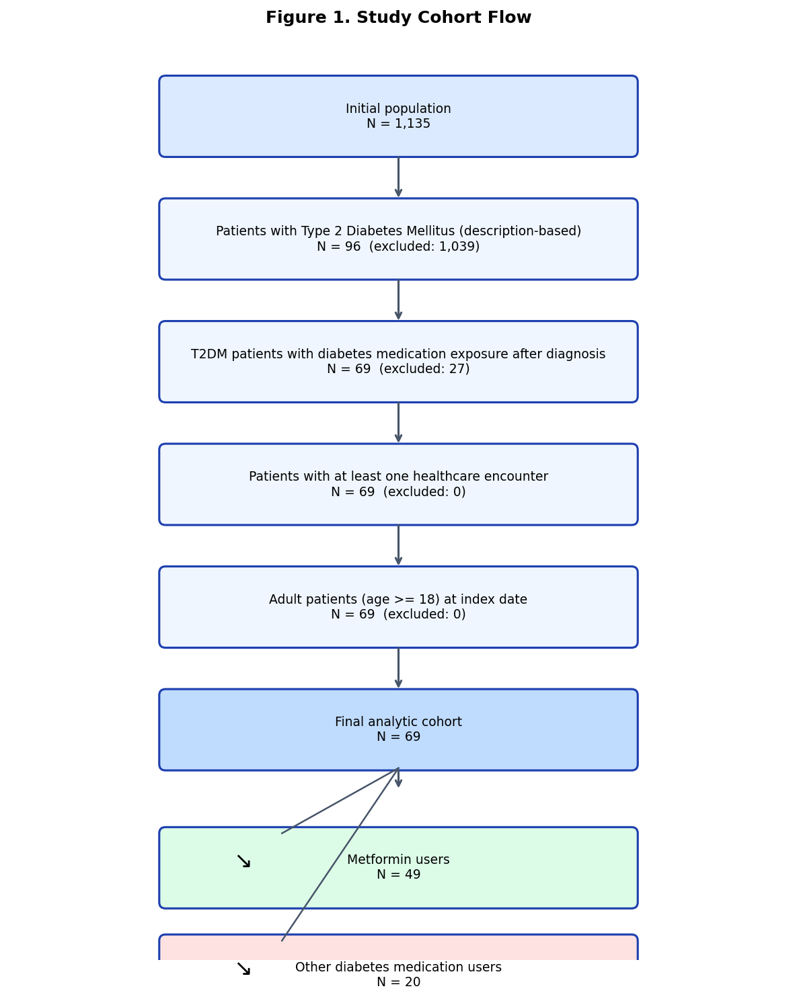

# Synthetic RWE Diabetes Treatment Study

An end-to-end real-world evidence (RWE) methods demonstration using synthetic EHR data generated by Synthea. The project implements an observational cohort workflow from data quality assessment and cohort definition through baseline characterization, outcome analysis, propensity-score methods, advanced causal estimation, and report generation.

> **Important:** This project uses synthetic data for methodological demonstration. It does not establish the clinical efficacy or safety of any diabetes medication and should not be used for clinical decision-making.

## Portfolio Outputs

- [RWE Evidence Report (PDF)](reports/RWE_Evidence_Report.pdf)
- [RWE Evidence Report (HTML)](reports/RWE_Evidence_Report.html)
- [Table 1 — Baseline Characteristics](reports/Table1_Baseline.xlsx)
- [Table 2 — Outcomes](reports/Table2_Outcome.xlsx)
- [Table 3 — Treatment Effects](reports/Table3_Treatment_Effect.xlsx)
- [Cohort Flow Diagram](reports/figures/figure_cohort_flow.png)



*The cohort flow diagram documents the selection process from the source dataset to the final analysis cohort.*

## Research Question and Design

The prototype compares outcomes between:

- **Treatment A:** Metformin users
- **Treatment B:** Users of other diabetes medications

The study is framed as a retrospective observational cohort analysis. The primary outcome is a composite of diabetes-related complications or hospital/emergency encounters, as defined by the project workflow.

| Study element | Current implementation |
|---|---|
| Data source | Synthea synthetic EHR data |
| Study design | Retrospective observational cohort prototype |
| Final analysis cohort | 69 patients |
| Metformin group | 49 patients |
| Other-medication group | 20 patients |

The cohort is small, so estimates are imprecise and sensitive to modeling choices. Results are included to demonstrate analytical methods, not to support a treatment recommendation.

## End-to-End Workflow

| Step | Module | Main outputs |
|---|---|---|
| 0. Data profiling | `data_profile.py` | Dataset overview, field distributions, table relationships |
| 1. Data quality | `data_quality.py` | HTML data-quality report |
| 2. Cohort definition | `cohort_definition.py` | Study population and cohort flow |
| 3. Baseline characteristics | `baseline_analysis.py` | Baseline summary and Table 1 |
| 4. Treatment exposure | `treatment_exposure.py` | Exposure dataset and summary |
| 5. Outcome analysis | `outcome_analysis.py` | Outcome summaries, Kaplan–Meier and logistic results |
| 6. Propensity-score analysis | `causal_inference.py` | Matched cohort and treatment-effect results |
| 7. Advanced causal inference | `advanced_causal_inference.py` | Adjusted effect estimates, DoWhy and EconML outputs |
| 8. Evidence report generation | `rwe_report_generation.py` | HTML/PDF report and Excel tables |

The stages use outputs from preceding steps. Data profiling is optional; the final report consolidates the results of the analysis workflow.

## Statistical Methods

### Baseline characterization

- Table 1 generation, including standardized mean differences (SMD)
- t-tests or Mann–Whitney tests, as appropriate
- Chi-square or Fisher's exact tests, as appropriate
- Love plot for baseline balance assessment

### Outcome analysis

- Event rates per 100 patient-years
- Kaplan–Meier survival curves
- Log-rank testing
- Unadjusted logistic regression

### Propensity-score methods

- Logistic-regression propensity scores
- 1:1 nearest-neighbor matching
- Inverse probability of treatment weighting (IPTW)
- Matched-cohort logistic regression
- Risk-difference estimation

### Advanced causal estimation

- Multivariable regression
- IPTW estimates for ATE and ATT
- Augmented inverse probability weighting (AIPW)
- Bootstrap confidence intervals
- DoWhy causal-model checks
- EconML LinearDML
- Sensitivity and subgroup analyses

The workflow documents key causal assumptions, including exchangeability, positivity, and consistency. These assumptions cannot be established merely by running the code.

## Illustrative Results

The current synthetic cohort produces the following results:

| Analysis | Current result |
|---|---|
| Unadjusted outcome comparison | Higher composite-outcome event rate in the other-medication group; log-rank p approximately 0.01 |
| Adjusted logistic regression (Other vs. Metformin) | OR 1.20; wide confidence interval; p = 0.89 |
| IPTW ATE risk difference (Metformin − Other) | +0.11; p = 0.34 |
| Propensity-score matching | 8 matched pairs |

These results illustrate why unadjusted differences should not be interpreted as causal effects. The small cohort and limited overlap constrain the reliability and precision of adjusted estimates.

## Technology Stack

- Python 3.10+
- pandas, NumPy, SciPy
- statsmodels, scikit-learn
- lifelines
- DoWhy, EconML
- Matplotlib, Seaborn
- Jinja2, openpyxl, xhtml2pdf
- Jupyter Notebook

## Quick Start

Install dependencies from the repository root:

```bash
pip install -r requirements.txt
```

### Option 1: Run the workflow step by step

The following commands are run from the `src/` directory:

```bash
python data_profile.py
python data_quality.py
python cohort_definition.py
python baseline_analysis.py
python treatment_exposure.py
python outcome_analysis.py
python causal_inference.py
python advanced_causal_inference.py
python rwe_report_generation.py
```

The data-profile step is optional. Run the remaining steps in order so each stage can use the preceding outputs.

### Option 2: Explore the notebooks

```bash
cd notebooks
jupyter notebook
```

Run notebooks `01` through `08` in order.

## Key Deliverables

| File | Description |
|---|---|
| `reports/synthea_data_profile.md` | Dataset overview |
| `reports/RWE_Evidence_Report.html` | Full HTML evidence report |
| `reports/RWE_Evidence_Report.pdf` | PDF evidence report |
| `reports/Table1_Baseline.xlsx` | Baseline characteristics and SMD |
| `reports/Table2_Outcome.xlsx` | Outcomes, follow-up, and survival results |
| `reports/Table3_Treatment_Effect.xlsx` | PSM, IPTW, and regression-adjusted effects |
| `reports/figures/figure_cohort_flow.png` | Cohort selection diagram |

## Limitations

- All records are synthetic and do not represent real patients.
- The final cohort is small, with only 69 patients and 8 matched pairs in the current matching analysis.
- The study is not powered to establish clinical efficacy or safety.
- Residual confounding, positivity violations, model misspecification, and uncertainty may affect causal estimates.
- The findings must not be generalized to real clinical populations or used for treatment decisions.

## License

See the repository's `LICENSE` file.
